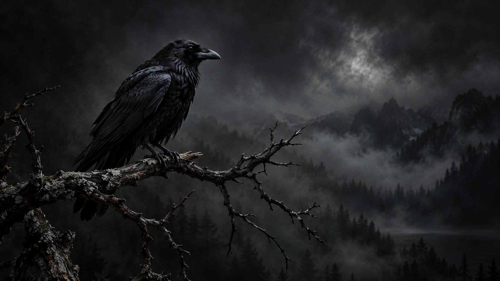

# Murder of Crows

A dark Omarchy theme with charcoal blacks, ash text, and cool pewter accents. Eleven original crow wallpapers pair atmospheric wildlife photography with mist, weathered stone, and quiet landscapes.



## Install

```sh
omarchy theme install https://github.com/RobbieUK1/omarchy-murder-of-crows
omarchy theme set "Murder of Crows"
```

Omarchy installs repository themes using the repository name after removing the `omarchy-` prefix.

## Wallpapers

Open the background picker with **Super + Ctrl + Space**, or cycle from a terminal:

```sh
omarchy theme bg next
```

| Wallpaper | Scene |
| --- | --- |
| 01 · Solitude | A lone crow above a misty forest valley |
| 02 · Companions | A pair of crows |
| 03 · The Murder | A loose flock in charcoal mist |
| 04 · The Sentinel | A crow on a weathered stone gatepost |
| 05 · Blackwater | A crow reflected at a still lake |
| 06 · Wings of Ash | A crow gliding over a fog-filled valley |
| 07 · Winter Watch | Two crows on frost-covered branches |
| 08 · The Roost | Crows in a skeletal oak |
| 09 · Rainkeeper | A rain-soaked crow on a slate rooftop |
| 10 · Stone and Feather | A crow on a ruined stone arch |
| 11 · Last Light | Three crows on a moorland fence |

## Palette

- Background: `#101114`
- Foreground: `#d6d8de`
- Accent: `#b5bdc9`
- Selection: `#323740`

Omarchy generates supported application configurations from `colors.toml`. The theme includes the `Yaru-blue` icon preference.

## Artwork

Created with the built-in imagegen tool. The original prompt set used widescreen gothic wildlife fine-art photography: a solitary crow on a bare branch, a pair, and a loose flying flock. All use charcoal blacks, faint cool pewter highlights, and generous negative space.

The eight additional prompts are recorded in [PROMPTS.md](PROMPTS.md). Each image was generated separately for this collection.
