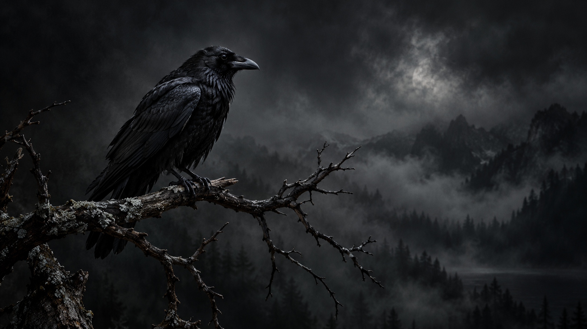

# Murder of Crows

A true-black OLED Omarchy theme with pure `#000000` interface backgrounds, ash text, and cool pewter accents. Eleven original crow wallpapers pair atmospheric wildlife photography with mist, weathered stone, and quiet landscapes.



## Install

```sh
omarchy theme install https://github.com/RobbieUK1/omarchy-murder-of-crows
omarchy theme set "Murder of Crows"
```

Omarchy installs repository themes using the repository name after removing the `omarchy-` prefix.

## Wallpapers

Open the background picker with **Super + Ctrl + Space**, or cycle from a terminal:

```sh
omarchy theme bg next
```

| Wallpaper | Scene |
| --- | --- |
| 01 · Solitude | A lone crow above a misty forest valley |
| 02 · Companions | A pair of crows |
| 03 · The Murder | A loose flock in charcoal mist |
| 04 · The Sentinel | A crow on a weathered stone gatepost |
| 05 · Blackwater | A crow reflected at a still lake |
| 06 · Wings of Ash | A crow gliding over a fog-filled valley |
| 07 · Winter Watch | Two crows on frost-covered branches |
| 08 · The Roost | Crows in a skeletal oak |
| 09 · Rainkeeper | A rain-soaked crow on a slate rooftop |
| 10 · Stone and Feather | A crow on a ruined stone arch |
| 11 · Last Light | Three crows on a moorland fence |

## Palette

- Background: `#000000` (true OLED black)
- Dark and darker backgrounds: `#000000`
- Raised surfaces: `#202329` (for visual separation)
- Foreground: `#d6d8de`
- Accent: `#b5bdc9`
- Selection: `#323740`

Omarchy generates supported application configurations from `colors.toml`. The theme includes the `Yaru-blue` icon preference.

## Artwork

Created with the built-in imagegen tool. The original prompt set used widescreen gothic wildlife fine-art photography: a solitary crow on a bare branch, a pair, and a loose flying flock. All use charcoal blacks, faint cool pewter highlights, and generous negative space.

The eight additional prompts are recorded in [PROMPTS.md](PROMPTS.md). Each image was generated separately for this collection.

## Optional independent wallpapers per monitor

On Omarchy releases with the **Quickshell shell background plugin**, enable
the add-on explicitly after installing the theme:

```sh
git clone https://github.com/RobbieUK1/omarchy-murder-of-crows.git
cd omarchy-murder-of-crows
bash scripts/install-randomizer.sh
```

Use the usual **Super + Ctrl + Space** picker or `omarchy theme bg next`.
Confirming any image reshuffles all currently connected displays, including
when you confirm the same picker image again. The clicked image is the trigger;
it is not pinned to a particular monitor. Canceling the picker keeps the current
arrangement. Connecting or disconnecting a monitor also reshuffles the set.

The add-on chooses from this theme's still images and your additional images in
`~/.config/omarchy/backgrounds/murder-of-crows/`. It avoids duplicate images
across monitors when there are enough, and avoids each monitor's previous image
when feasible. One image works normally; with fewer images than monitors,
duplicates are necessary. Video files are excluded from the random pool.
The normal current-background link remains the picker's selection, so lock-screen
and other tools reading that link continue to see a single selected wallpaper.

This installs a user-owned `crows.background` clone of your installed stock
renderer under `~/.config/omarchy/plugins/`. It retains the stock renderer's
IPC, click handling, theme colors and behavior outside Murder of Crows.
Randomized stills change directly rather than sharing the stock single-image
reveal animation. No theme palette or artwork is modified.

Requires Python 3 and the Omarchy shell/plugin commands. Older swaybg/swww
installations and changed renderer source layouts fail the compatibility check
before replacing anything. Existing custom background clones must be disabled
first. Re-running the installer rebuilds from the installed Omarchy version
and saves any previous `crows.background` directory as a timestamped backup.
After an Omarchy update, rerun the installer to pick up renderer changes.

Disable the add-on and restore the stock renderer:

```sh
bash scripts/install-randomizer.sh --remove
```

Disabling retains the plugin files and backups for recovery; it does not remove
wallpapers or change the theme. Installing a theme alone does not run scripts.

### Development checks

```sh
node tests/randomize.test.cjs
python3 -B -m unittest discover -s tests -v
bash -n scripts/install-randomizer.sh
```

Tests cover repeated independent assignment, no avoidable duplicates/repeats,
monitor-list changes, empty/single/short image pools, theme scoping, filename
handling, and fail-closed generation against the locally installed renderer.
A real multi-monitor Hyprland session should additionally be checked for picker
confirmation/cancellation, restart, hotplug and switching to another theme.

